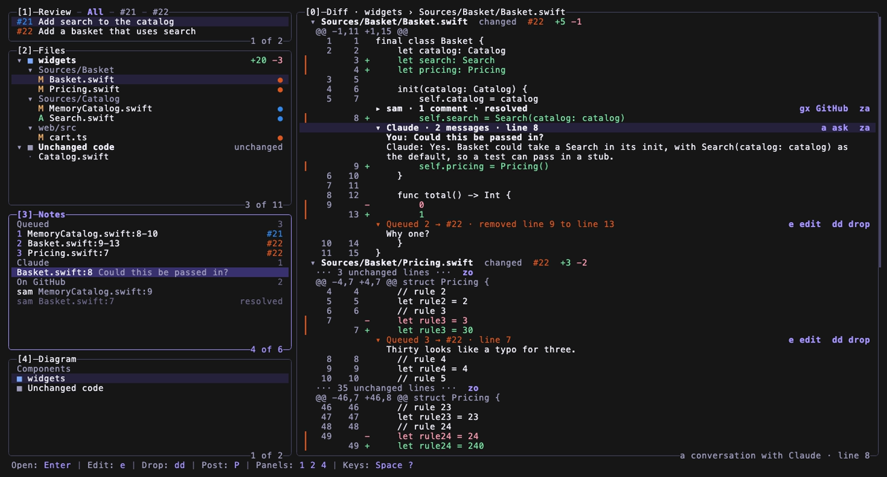
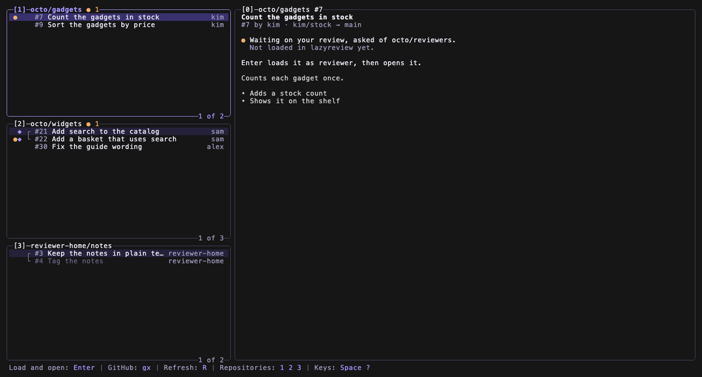

# lazyreview

Review GitHub pull requests on your own machine, in a terminal or a browser.

One command loads a pull request, a stack of pull requests, or a branch with
no pull request yet. lazyreview then shows a class diagram of the change,
every diff, the threads already on GitHub and the comments you queue. One
press posts your review. Ask Claude about a line, and the answer stays beside
it.

## What you need

- Node.js 22 or later
- git, and the GitHub command line `gh`, signed in
- Go 1.24 or later, for the terminal app
- Claude Code (`claude`), signed in, only to ask about a line

lazyreview has no packages to install. Its few libraries are in the
repository, so it reaches no network except through `gh`, git and Claude
Code. It is tested on macOS.

## Start

    git clone https://github.com/connorb645/lazyreview
    cd lazyreview
    bin/lazyreview load https://github.com/owner/repo/pull/12

`load` starts the app on http://127.0.0.1:4747 and prints the address to
open. The app listens on this machine only.

To load a stack, name each pull request, bottom first. To load a branch with
no pull request, name the folder, the base and the branch:

    bin/lazyreview load --repo ~/code/widgets --base main --head feature/search

To open a review in the terminal app, give it the same link:

    bin/lazyreview terminal https://github.com/owner/repo/pull/12

The terminal app is laid out as in Lazygit, with Vim keys. `Space ?` lists
every key.

With no link, the terminal app opens on a home screen. The home screen lists
the open pull requests that involve your GitHub accounts, by repository. Name
the accounts in `~/.lazyreview/settings.json`, as
[the guide](docs/guide.md#the-home-screen) shows.

## More

[The guide](docs/guide.md) covers stacks, written reviews, the web app,
every key of the terminal app, components and packages, the settings and
where the data is kept.

Run the tests with `npm test`, and the terminal app's tests with
`npm run test:terminal`. The tests reach no network.

## Licence

MIT. The libraries in `vendor/` and `terminal/vendor/` keep their own
licences.
